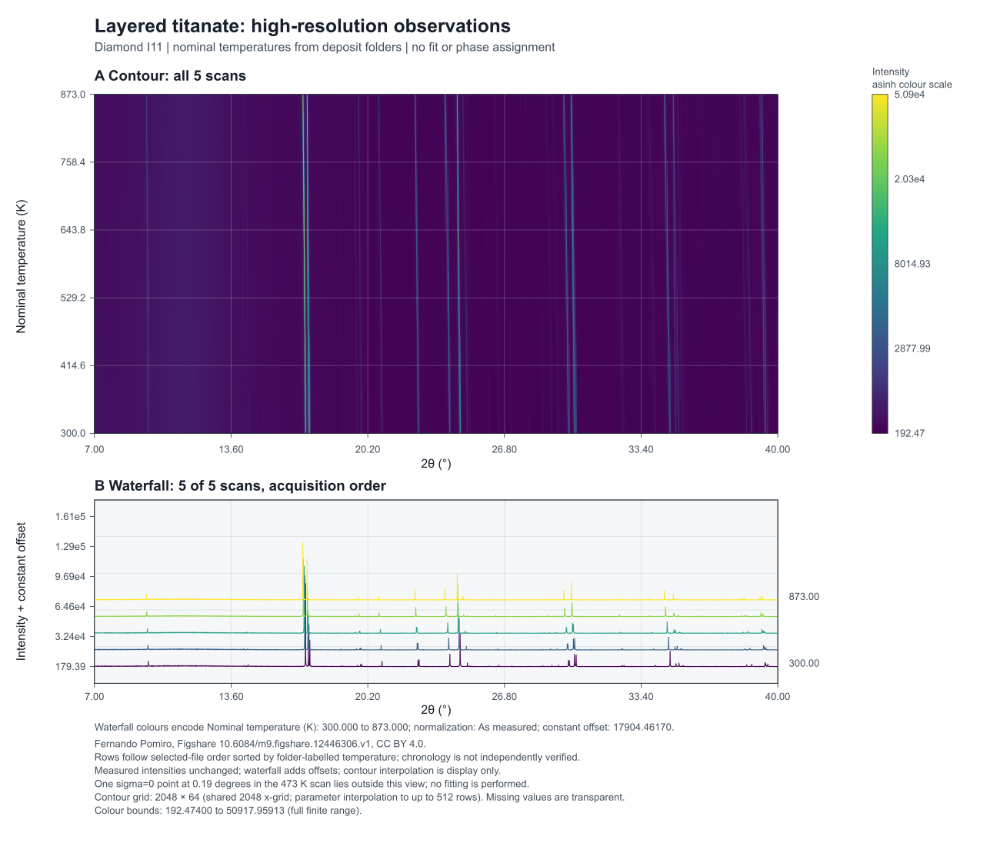

# Crystal representation benchmark

**A generic periodic occupation core, with reproducible mathematical controls and an external geometry test.** The current release preserves source populations, explicit periodic exclusions and diffraction amplitudes across declared supercells. It does not identify a measured ordered structure.

[Two-page result report](report/REPORT.pdf) · [Protocol](protocol/PROTOCOL.md) · [API contract](src/crystalbench/CONTRACT.md) · [Numerical receipt](results/run002/RESULT.json)

## What ran

- **47 implementation tests passed.** Integer supercells include off-diagonal transformations; configurations retain source/tile mappings, exact species counts and supplied exclusion witnesses.
- **Six synthetic transforms and four ring fixtures:** independent rational cosets, scalar complex sums, periodic boundary checks and CIF round trips. Exact enumeration of all 495 four-of-twelve occupations verifies a non-identifiable pair without calling the core's enumerator.
- **One external source CIF:** a deposited layered-titanate average structure, with 60 explicit site/species records and 48 occupancy-weighted atoms per cell. On 2,197 integer reciprocal vectors, the parent-cell amplitudes agree with Gemmi's separately implemented calculator to a maximum absolute difference of **4.08e-13**. Two nontrivial repeated-cell representations also pass their complete declared grids.
- The final receipt contains **57 passing checks and two not-applicable checks** (determinant-one cells have no extra satellites). These are not 57 independent materials or experiments.

The CIF has no ADPs. This is an explicit **zero-ADP, neutral-IT92, no-anomalous-scattering control**. Gemmi supplies both symmetry admission and scattering tables; its structure-factor calculator is separate, but the crystallographic inputs/tables are shared. There is no fitted scale or background repair.

## What changed during review

Protocol and clarifications were published before evaluation. Run001 passed its finite registered controls. Review then found a larger numerical-range defect involving very large unwrapped coordinates. The original source and result are preserved; version 0.1.1 corrects phase evaluation and expansion, with new regression tests. [Amendment 02](protocol/AMENDMENT_02.md) records the change.

**VT07 is therefore a development/revalidation case for the revised code, not a held-out or blind validation.** A fresh material is required for the next transfer claim. Even the initial source was inspected for admission before evaluation.

## Reproduce

Tested environment: Python 3.14.2, NumPy 2.4.6, Gemmi 0.7.5. Exact dependency versions are in `requirements-benchmark.txt`. From this directory:

```sh
python3 -m venv .venv
.venv/bin/python -m pip install -r requirements-benchmark.txt
.venv/bin/python -m pip install --no-deps --no-build-isolation -e .
.venv/bin/python -m pytest -q
OPENBLAS_NUM_THREADS=1 OMP_NUM_THREADS=1 .venv/bin/python scripts/run_benchmark.py --output results/my-run --stage all
```

The output directory must be new. Each run records source/protocol/runner hashes before calculation and checks that the frozen core remains unchanged. The small external CIF is bundled under its explicit CC BY 4.0 terms; no large download is needed for the numerical benchmark. The first run's exact source snapshot is retained under `results/run001/frozen-source.zip`.

## Measured data view, rendered with Rust Powder Plot



[Vector SVG](figures/vt07-series-v2.svg) · [Figure PDF](figures/vt07-series-v2.pdf) · [Source attribution and admission](data/vt07/README.md)

Five deposited observations, 75,000 points each. Intensities are not normalized per scan; waterfall offsets and contour interpolation are display operations. Temperatures come from deposit folder labels. The renderer's fixed heading says “acquisition order”; here it means selected-file order, sorted by those labels, not independently verified chronology. One zero-sigma point in the 473 K scan lies at 0.19°, outside the displayed 7–40° interval. It is not admitted to a weighted fit.

To regenerate using the existing Rust application and the pinned source archive:

```sh
.venv/bin/python scripts/render_powder_figure.py \
  --archive /path/to/Cif_files_and_exp_data.zip \
  --plotter /path/to/powder-plot \
  --output /path/to/new-figure-directory
```

The native exporter produces SVG. The included PDF/PNG were converted with librsvg; the rendered figure and final report pages were visually inspected. No plotting backend was substituted for Powder Plot.

## Scientific limits and next test

The published TOPAS input and the bundled CIF are different structural models, and the input references an absent XYE filename. **Published powder-profile reproduction and observed-data structural inference remain unassessed.** The observation figure is not an observed/calculated fit.

The occupation examples are periodic mathematical controls. They demonstrate equal populations with different intensities, and distinct patterns with identical discrete intensities. They do not establish chemical plausibility or experimental uniqueness. Known-ADP serialization, comprehensive isotropic damping transfer, displacive modes, magnetic scattering and performance advantage require further tests.

Next: admit a fresh occupational material with a traceable structure and instrument model; freeze the revised core before evaluation. An Fe7S8 vacancy-order case is a candidate, but its matching structural and instrument inputs remain unresolved. Keep that scientific test separate from fixing the current TOPAS/CIF source mismatch.

The repository contains generic code, synthetic fixtures and explicitly licensed public source material. No private structures or legacy private implementation are included. This benchmark does not establish novelty over existing configurational or symmetry-mode tools; that comparison is a separate work item.
